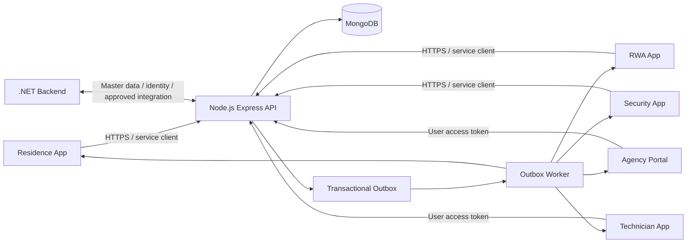
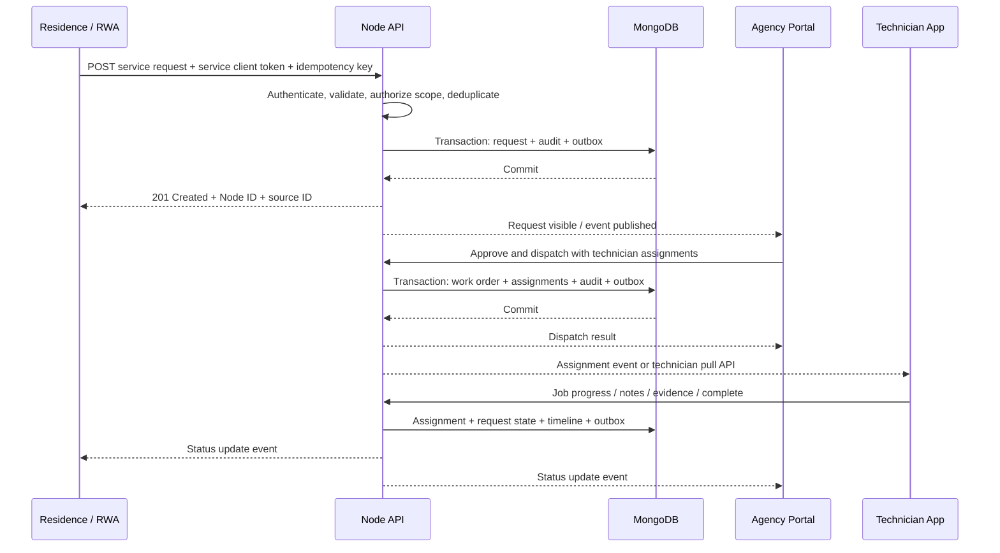
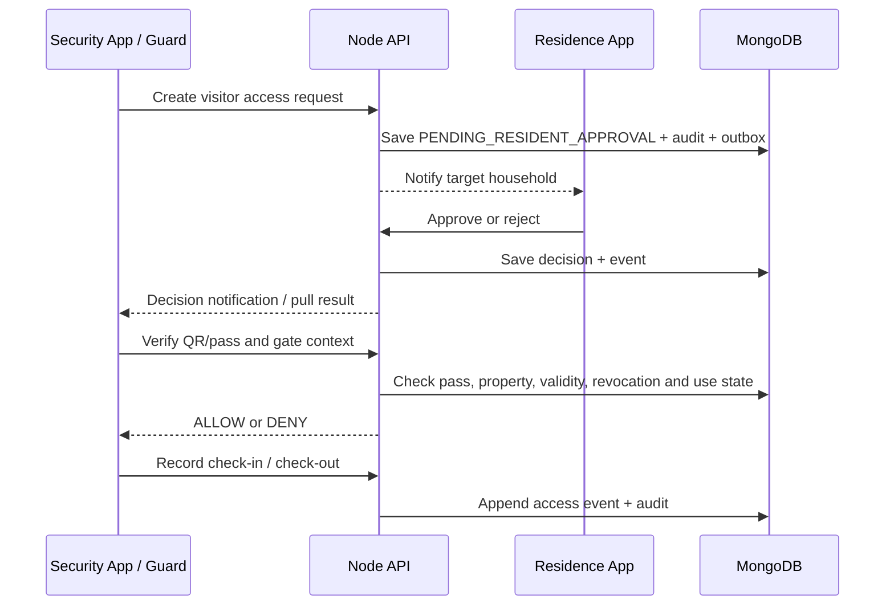
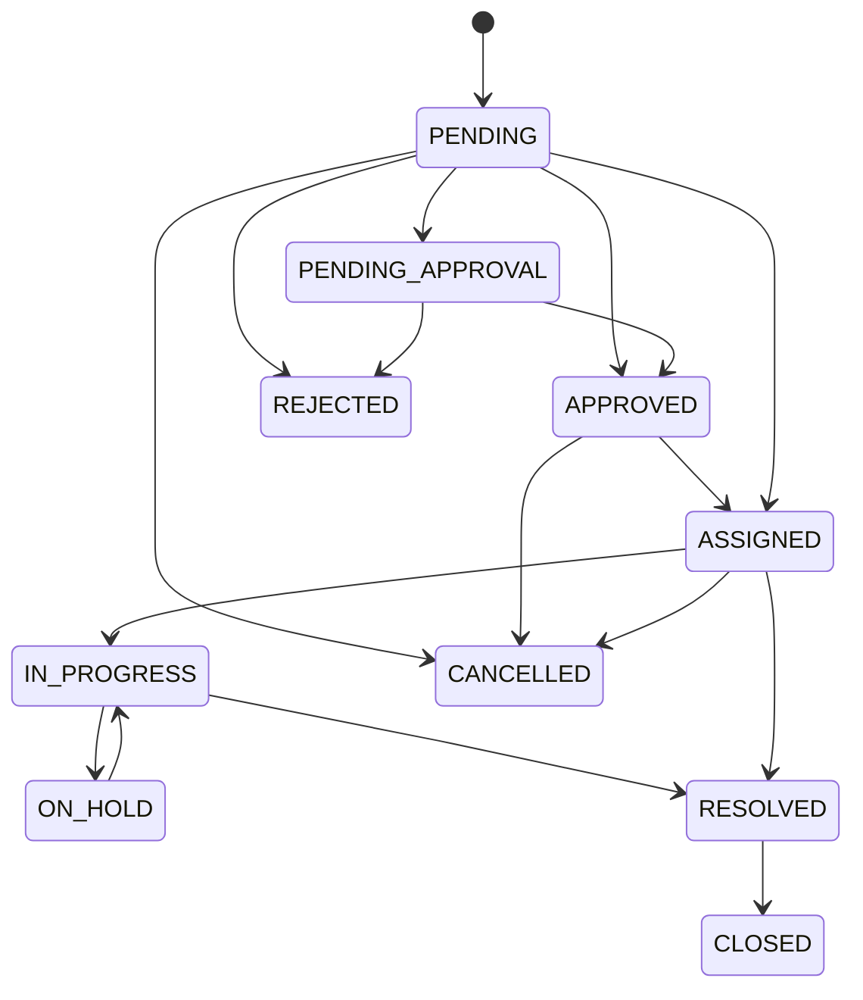
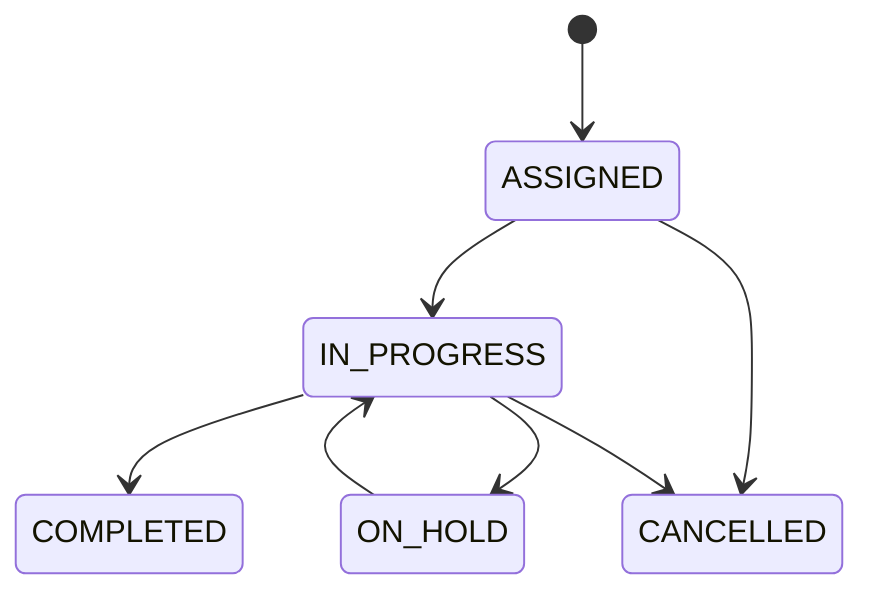

# Backend Design Document

## BEE Property Service & Access API

**Backend:** Node.js + Express.js  
**Persistence:** MongoDB + Mongoose  
**Architecture:** Modular monolith, domain-oriented layers, API-first integration  
**API prefix:** `/api/v1`  
**Primary consumers:** Residence, RWA, Agency, Technician, Security, and approved .NET integration clients

---

## 1. Architecture decisions

### 1.1 Modular monolith first

Implement one deployable Node.js service with clear internal modules. Keep service request, work order, technician assignment, gate-pass, identity integration and notification code isolated by domain. Do not split into many microservices at the start. The modular structure allows later extraction without introducing distributed transactions into the initial release.

### 1.2 Responsibilities alongside .NET



- Node is the source of truth for service requests, work orders, technician assignments, gate-pass requests/passes and gate-access events.
- .NET remains the owner of its existing domains. No direct cross-database reads/writes are permitted.
- When Node needs identity, apartment, resident, or property validation, it calls a trusted .NET/master-data contract or validates signed claims from the central issuer plus a verified membership lookup.
- If the project already has Azure Service Bus or another message broker, the outbox relay can publish to it. Otherwise use signed webhooks with retries. Domain services must depend on an `EventPublisher` interface, not a specific transport.

### 1.3 Data flow sequence: service request to technician



### 1.4 Data flow sequence: visitor approval and gate entry



---

## 2. Project structure

Use the user's requested layers: **router → middleware → controller → service → business service → model → MongoDB**. Keep transport, orchestration, domain policy and persistence separate.

```text
bee-service-api/
├── src/
│   ├── app.js
│   ├── server.js
│   ├── config/
│   │   ├── env.js
│   │   ├── database.js
│   │   ├── cors.js
│   │   ├── security.js
│   │   ├── logger.js
│   │   └── constants.js
│   ├── routes/
│   │   └── v1/
│   │       ├── index.routes.js
│   │       ├── auth.routes.js
│   │       ├── integration.routes.js
│   │       ├── service-request.routes.js
│   │       ├── agency.routes.js
│   │       ├── work-order.routes.js
│   │       ├── technician.routes.js
│   │       ├── gate-pass-request.routes.js
│   │       ├── gate-pass.routes.js
│   │       ├── security.routes.js
│   │       └── health.routes.js
│   ├── controllers/
│   │   ├── auth.controller.js
│   │   ├── integration.controller.js
│   │   ├── service-request.controller.js
│   │   ├── agency.controller.js
│   │   ├── work-order.controller.js
│   │   ├── technician.controller.js
│   │   ├── gate-pass-request.controller.js
│   │   ├── gate-pass.controller.js
│   │   └── security.controller.js
│   ├── middleware/
│   │   ├── authenticate.middleware.js
│   │   ├── authenticate-client.middleware.js
│   │   ├── authorize.middleware.js
│   │   ├── property-scope.middleware.js
│   │   ├── validate.middleware.js
│   │   ├── idempotency.middleware.js
│   │   ├── rate-limit.middleware.js
│   │   ├── request-context.middleware.js
│   │   ├── webhook-signature.middleware.js
│   │   ├── not-found.middleware.js
│   │   └── error-handler.middleware.js
│   ├── validators/
│   │   ├── auth.schemas.js
│   │   ├── service-request.schemas.js
│   │   ├── work-order.schemas.js
│   │   ├── technician.schemas.js
│   │   ├── gate-pass.schemas.js
│   │   └── integration.schemas.js
│   ├── services/
│   │   ├── auth.service.js
│   │   ├── service-request.service.js
│   │   ├── agency-dispatch.service.js
│   │   ├── work-order.service.js
│   │   ├── technician.service.js
│   │   ├── gate-pass.service.js
│   │   ├── security-access.service.js
│   │   ├── notification.service.js
│   │   ├── audit.service.js
│   │   └── integration.service.js
│   ├── business-services/
│   │   ├── service-request.business-service.js
│   │   ├── approval-policy.business-service.js
│   │   ├── dispatch.business-service.js
│   │   ├── technician-assignment.business-service.js
│   │   ├── work-order-lifecycle.business-service.js
│   │   ├── gate-pass-policy.business-service.js
│   │   ├── gate-pass-verification.business-service.js
│   │   └── access-decision.business-service.js
│   ├── models/
│   │   ├── ServiceRequest.model.js
│   │   ├── WorkOrder.model.js
│   │   ├── WorkOrderAssignment.model.js
│   │   ├── TechnicianProfile.model.js
│   │   ├── GatePassRequest.model.js
│   │   ├── GatePass.model.js
│   │   ├── GateAccessEvent.model.js
│   │   ├── RefreshSession.model.js
│   │   ├── AuditEvent.model.js
│   │   ├── OutboxEvent.model.js
│   │   ├── IdempotencyRecord.model.js
│   │   └── IntegrationClient.model.js
│   ├── repositories/
│   │   ├── service-request.repository.js
│   │   ├── work-order.repository.js
│   │   ├── assignment.repository.js
│   │   ├── gate-pass.repository.js
│   │   ├── audit.repository.js
│   │   └── outbox.repository.js
│   ├── integrations/
│   │   ├── identity/
│   │   │   ├── token-verifier.js
│   │   │   ├── jwks-client.js
│   │   │   └── identity-provider.adapter.js
│   │   ├── dotnet/
│   │   │   ├── dotnet-client.js
│   │   │   └── master-data.adapter.js
│   │   ├── residence/
│   │   │   └── residence.adapter.js
│   │   ├── rwa/
│   │   │   └── rwa.adapter.js
│   │   ├── agency/
│   │   │   └── agency.adapter.js
│   │   ├── technician/
│   │   │   └── technician.adapter.js
│   │   ├── security/
│   │   │   └── security.adapter.js
│   │   ├── storage/
│   │   │   └── object-storage.adapter.js
│   │   └── messaging/
│   │       ├── event-publisher.interface.js
│   │       └── webhook-event-publisher.js
│   ├── workers/
│   │   ├── outbox-publisher.worker.js
│   │   ├── expired-pass.worker.js
│   │   └── stale-idempotency.worker.js
│   ├── events/
│   │   ├── event-types.js
│   │   ├── event-envelope.js
│   │   └── event-handlers.js
│   ├── utils/
│   │   ├── ApiError.js
│   │   ├── async-handler.js
│   │   ├── crypto.js
│   │   ├── date-time.js
│   │   ├── pagination.js
│   │   └── sanitize-log.js
│   └── docs/
│       └── openapi.yaml
├── tests/
│   ├── unit/
│   ├── integration/
│   ├── contract/
│   ├── security/
│   └── fixtures/
├── scripts/
│   ├── create-service-client.js
│   └── seed-development-only.js
├── .env.example
├── .gitignore
├── package.json
├── package-lock.json
├── README.md
├── prd.md
└── design.md
```

### 2.1 Layer responsibilities

| Layer | Responsibility | Must not do |
|---|---|---|
| Router | HTTP method/path, route-specific middleware chain | Business rules or MongoDB queries |
| Middleware | Authentication, client authentication, authorization, scope, validation, idempotency, request context, error mapping | Perform the full workflow |
| Controller | Parse validated request context, call one service, format HTTP response | Direct model operations or domain decisions |
| Service | Application orchestration, transactions, repository calls, integration calls, event creation | Re-implement policy in controllers |
| Business service | Pure/domain-focused rules: approval, transitions, assignment eligibility, pass verification | HTTP request/response handling |
| Repository | Encapsulate Mongoose reads/writes and query scope | Decide whether an action is allowed |
| Model | MongoDB schema, indexes, constraints, serialization | Accept raw unvalidated request body |
| Worker | Outbox delivery, retries, pass expiry, cleanup | Bypass business service or audit logging |

**Naming note:** use `controllers/` for the user's requested “control” layer. Keep `services/` for use-case orchestration and `business-services/` for domain rules, so the two service layers have distinct jobs.

---

## 3. Core data model design

Use Mongoose schemas with explicit field definitions, strict mode, validation, timestamps, and indexes. Prefer MongoDB replica-set/Atlas deployment so transactions can be used for multi-document operations.

### 3.1 `ServiceRequest`

Purpose: canonical request aggregate received from Residence or RWA.

```js
{
  publicId: String,                 // SR-YYYY-000001; unique
  source: {
    application: String,            // RESIDENCE | RWA
    sourceRequestId: String,        // e.g. TKT-... or CMP-...
    sourceEventId: String,
    sourceStatus: String,
    sourceCreatedAt: Date
  },
  property: {
    propertyId: String,             // verified external master-data ID
    householdId: String,             // Residence household reference where applicable
    communityId: String,
    societyId: String,
    apartmentId: String,
    apartmentNameSnapshot: String,
    towerId: String,
    towerNameSnapshot: String,
    floor: String,
    flatNumber: String,
    placeName: String,
    asset: String,
    complaintScope: String         // e.g. COMMON_AREA | INDIVIDUAL_UNIT
  },
  requester: {
    userId: String,                 // verified identity subject/source ID
    roleAtSubmission: String,
    displayNameSnapshot: String
  },
  classification: {
    category: String,
    issueType: String,
    serviceType: String
  },
  title: String,
  description: String,
  priority: String,                 // URGENT | HIGH | NORMAL | LOW
  status: String,                   // canonical status from PRD
  approval: {
    required: Boolean,
    status: String,                 // NOT_REQUIRED | PENDING | APPROVED | REJECTED
    approvedBy: String,
    approvedAt: Date,
    reason: String
  },
  preferredSchedule: { date: Date, timeSlot: String },
  attachments: [{
    attachmentId: String,
    kind: String,                   // ISSUE | VOICE_NOTE | OTHER
    storageKey: String,
    fileName: String,
    mimeType: String,
    sizeBytes: Number,
    checksum: String,
    uploadedBy: String,
    createdAt: Date
  }],
  workOrderIds: [ObjectId],
  sourceSnapshot: Object,            // bounded, redacted, schema-versioned snapshot
  version: Number,
  createdAt: Date,
  updatedAt: Date,
  createdBy: String,
  updatedBy: String
}
```

Indexes:

- Unique `{ 'source.application': 1, 'source.sourceRequestId': 1 }`.
- Unique `{ publicId: 1 }`.
- `{ 'property.propertyId': 1, status: 1, priority: 1, createdAt: -1 }`.
- `{ status: 1, createdAt: -1 }`.
- `{ 'requester.userId': 1, createdAt: -1 }`.

### 3.2 `WorkOrder`

Purpose: Agency's dispatch/work scope linked to one service request. It can have multiple technician assignments.

```js
{
  publicId: String,                 // WO-YYYY-000001; unique
  serviceRequestId: ObjectId,
  caseOrderId: String,              // Agency display/integration reference
  title: String,
  instructions: String,
  agencyId: String,
  propertyId: String,
  status: String,                   // OPEN | PARTIALLY_ASSIGNED | ASSIGNED | IN_PROGRESS | ON_HOLD | RESOLVED | CLOSED | CANCELLED
  priority: String,
  targetDate: Date,
  assignmentIds: [ObjectId],        // references WorkOrderAssignment documents
  createdBy: String,
  updatedBy: String,
  createdAt: Date,
  updatedAt: Date,
  version: Number
}
```

Indexes:

- Unique `{ publicId: 1 }`.
- `{ serviceRequestId: 1, createdAt: -1 }`.
- `{ propertyId: 1, status: 1, targetDate: 1 }`.

### 3.3 `WorkOrderAssignment` (separate collection)

A separate collection is recommended for clean technician-level authorization and updates when multiple technicians work on one order.

```js
{
  publicId: String,                 // ASG-...
  workOrderId: ObjectId,
  serviceRequestId: ObjectId,
  serviceOrderId: String,            // SO-...
  technicianId: String,
  role: String,
  skillSnapshot: String,
  instructions: String,
  status: String,
  assignedAt: Date,
  targetDate: Date,
  startedAt: Date,
  completedAt: Date,
  hold: { reason: String, createdAt: Date, createdBy: String },
  materialRequests: [{ itemId: String, name: String, quantity: Number, status: String }],
  checkIn: { at: Date, latitude: Number, longitude: Number, evidenceKey: String },
  checkOut: { at: Date, latitude: Number, longitude: Number },
  notes: [{ noteId: String, text: String, createdAt: Date, createdBy: String }],
  beforePhotos: [{ attachmentId: String, storageKey: String, caption: String, createdAt: Date }],
  afterPhotos: [{ attachmentId: String, storageKey: String, caption: String, createdAt: Date }],
  createdAt: Date,
  updatedAt: Date,
  version: Number
}
```

Indexes:

- Unique `{ publicId: 1 }` and `{ serviceOrderId: 1 }`.
- Unique `{ serviceOrderId: 1 }`.
- `{ technicianId: 1, status: 1, targetDate: 1 }`.
- `{ workOrderId: 1, status: 1 }`.

### 3.4 `TechnicianProfile`

Purpose: limited operational snapshot of the technician directory used for eligibility. Agency remains the master unless ownership is explicitly moved.

Fields: `externalTechnicianId`, `nameSnapshot`, `skills[]`, `roleDirectives[]`, `status`, `coveragePropertyIds[]`, `sourceApplication`, `syncedAt`, `active`.

Do not store technician login passwords here. The Technician app identity must resolve to the same `externalTechnicianId` through the trusted identity/master-data mapping.

### 3.5 `ExternalPropertyReference`

Purpose: verified mapping from app-specific property identifiers to one canonical property identity. The current JSON fixtures do not share a cross-application key: Residence, RWA, Security, Agency and Technician examples use different property IDs/names/addresses. Do not infer that records belong to the same physical property from names or flat labels. The authoritative .NET/master-data service must approve the mapping; Node may keep a read-only/cache copy for fast validation.

Fields: `sourceApplication`, `sourcePropertyId`, `canonicalPropertyId`, `communityId`, `societyId`, `towerMappings[]` (source tower ID/code → canonical tower ID), `unitMappings[]` (source flat/unit ref → canonical unit ID), `mappingStatus` (`PENDING`, `VERIFIED`, `REJECTED`), `verifiedBy`, `verifiedAt`, `sourceVersion`, `syncedAt`.

Indexes: unique `{ sourceApplication: 1, sourcePropertyId: 1 }`; `{ canonicalPropertyId: 1 }`; validate tower/unit mappings with unique compound indexes where the schema stores them as separate documents. Requests with an unmapped or non-verified property reference must not enter dispatch.

### 3.6 `GatePassRequest`

Purpose: an inbound request requiring validation/approval before a pass is issued.

```js
{
  publicId: String,                 // GPR-...
  source: { application: String, sourceRequestId: String, sourceEventId: String },
  requestType: String,              // RESIDENT_GUEST | DELIVERY | CONTRACTOR | TECHNICIAN_WORK_ORDER | SECURITY_ARRIVAL
  propertyId: String,
  societyId: String,
  householdId: String,
  flatNumber: String,
  requestedBy: { subjectId: String, role: String, clientId: String },
  visitor: {
    name: String,
    phone: String,
    organization: String,
    category: String,
    vehicleNumber: String,
    purpose: String
  },
  technician: { technicianId: String, workOrderId: ObjectId, assignmentId: ObjectId },
  expectedAt: Date,
  validFrom: Date,
  validUntil: Date,
  accessGate: String,
  accessInstructions: String,
  approval: {
    required: Boolean,
    status: String,                 // NOT_REQUIRED | PENDING | APPROVED | REJECTED
    approverId: String,
    decidedAt: Date,
    reason: String
  },
  status: String,                   // PENDING_APPROVAL | APPROVED | REJECTED | ISSUED | CANCELLED | EXPIRED
  issuedPassId: ObjectId,
  createdAt: Date,
  updatedAt: Date
}
```

Indexes:

- Unique sparse `{ 'source.application': 1, 'source.sourceRequestId': 1 }` for upstream deduplication.
- `{ propertyId: 1, status: 1, expectedAt: 1 }`.
- `{ householdId: 1, createdAt: -1 }`.

### 3.7 `GatePass`

Purpose: actual access credential issued after required approval.

```js
{
  publicId: String,                 // GP-YYYY-000001
  passType: String,                 // GUEST | DELIVERY | CONTRACTOR | TECHNICIAN
  requestId: ObjectId,
  sourceApplication: String,
  propertyId: String,
  societyId: String,
  householdId: String,
  flatNumber: String,
  linkedWorkOrderId: ObjectId,
  linkedAssignmentId: ObjectId,
  visitor: { name: String, phoneSnapshot: String, organization: String, vehicleNumber: String, purpose: String },
  technician: { technicianId: String, nameSnapshot: String, phoneSnapshot: String },
  validFrom: Date,
  validUntil: Date,
  accessGate: String,
  accessInstructions: String,
  status: String,                   // ACTIVE | USED | REVOKED | EXPIRED
  tokenHash: String,                // hash of random opaque QR token; never the raw token
  otpHash: String,                  // optional; never the plaintext OTP
  usagePolicy: String,              // SINGLE_ENTRY | MULTI_ENTRY_WITHIN_WINDOW
  maxEntries: Number,
  entryCount: Number,
  issuedBy: String,
  issuedAt: Date,
  revokedBy: String,
  revokedAt: Date,
  revokeReason: String,
  createdAt: Date,
  updatedAt: Date
}
```

Indexes:

- Unique `{ publicId: 1 }`.
- Unique `{ tokenHash: 1 }`.
- `{ propertyId: 1, status: 1, validUntil: 1 }`.
- `{ linkedWorkOrderId: 1 }`.
- TTL index may be used only for archival/cleanup copies. Do **not** TTL-delete active passes or audit facts before the business retention period; expired passes should remain queryable and verifiable as expired.

### 3.8 `GateAccessEvent`

Append-only record of access attempts and visits.

Fields: `passId`, `requestId`, `propertyId`, `gateId`, `guardSubjectId`, `eventType` (`VERIFY_ALLOWED`, `VERIFY_DENIED`, `CHECKED_IN`, `CHECKED_OUT`), `decisionCode`, `occurredAt`, `deviceId`, `correlationId`, `safeMetadata`.

Indexes: `{ passId: 1, occurredAt: -1 }`, `{ propertyId: 1, occurredAt: -1 }`, `{ gateId: 1, occurredAt: -1 }`.

### 3.9 `RefreshSession` (only if Node is the designated token issuer)

Store refresh-token families/sessions, not raw refresh tokens.

Fields: `sessionId`, `subjectId`, `clientId`, `refreshTokenHash`, `tokenFamilyId`, `scopes[]`, `audiences[]`, `issuedAt`, `expiresAt`, `lastUsedAt`, `revokedAt`, `revokeReason`, `replacedByTokenHash`, `deviceLabel`, `ipHash`, `userAgentHash`, `createdAt`.

Indexes: unique `refreshTokenHash`; `{ tokenFamilyId: 1 }`; `{ subjectId: 1, revokedAt: 1 }`; TTL only after revocation/expiry retention policy permits deletion.

### 3.10 `AuditEvent`

Fields: `eventId`, `aggregateType`, `aggregateId`, `propertyId`, `actorType`, `actorId`, `clientId`, `action`, `fromStatus`, `toStatus`, `reason`, `requestId`, `correlationId`, `ipHash`, `occurredAt`, `metadataRedacted`.

Application code must never update an existing audit event. Restrict update/delete DB permissions for the runtime account where feasible.

### 3.11 `OutboxEvent`

Fields: `eventId` (unique), `eventType`, `eventVersion`, `aggregateType`, `aggregateId`, `payloadRedacted`, `destination`, `status` (`PENDING`, `IN_PROGRESS`, `DELIVERED`, `FAILED`, `DEAD_LETTER`), `attemptCount`, `nextAttemptAt`, `lastErrorCode`, `createdAt`, `deliveredAt`.

Indexes: unique `{ eventId: 1 }`; `{ status: 1, nextAttemptAt: 1 }`.

### 3.12 `IdempotencyRecord`

Fields: `clientId`, `idempotencyKey`, `requestHash`, `resourceType`, `resourceId`, `responseStatus`, `responseBodySafe`, `expiresAt`, `createdAt`.

Unique compound index `{ clientId: 1, idempotencyKey: 1 }`. A repeated key with a different request hash returns `409 IDEMPOTENCY_KEY_REUSED`.

---

## 4. API request lifecycle and middleware order

### 4.1 Global Express middleware order

1. `requestContext` — create/validate request ID, correlation ID, structured context.
2. `helmet` — security headers.
3. CORS — exact origin allowlist; do not use wildcard with credentials.
4. Raw-body capture only for routes that require webhook signature verification; do not globally keep duplicate raw bodies.
5. Body parser with strict JSON and small size limit (for example 1 MB; upload media separately).
6. Compression only where safe and appropriate.
7. Request logging with PII/token redaction.
8. Route-specific rate limiting.
9. `authenticateClient` or `authenticateUser`.
10. `authorize` and `propertyScope`.
11. `validate` request schema.
12. `idempotency` on write endpoints.
13. Controller.
14. Not-found middleware.
15. Central error-handler middleware.

### 4.2 Route example

```js
router.post(
  '/integrations/residence/service-requests',
  integrationRateLimit,
  authenticateClient('residence-api-client'),
  authorizeClientScope('service-requests:write'),
  validate(createResidenceServiceRequestSchema),
  requireIdempotencyKey,
  asyncHandler(integrationController.createResidenceServiceRequest)
);
```

A route must not rely on a front-end hiding a button. The backend authorization check is mandatory.

---

## 5. Authentication and token architecture

### 5.1 One issuer, several resource servers

The uploaded data describes demo roles but does not specify the current production identity provider. Inspect the existing .NET authentication before implementation.

- If .NET already acts as the identity provider, retain it as the single issuer. Node validates JWTs using the issuer's JWKS/public key and validates `iss`, `aud`, `exp`, `nbf`, `kid`, signature and permitted algorithm. `/auth/refresh` remains with the issuer; Node does not mint a competing refresh-token family.
- If no issuer exists and the project explicitly assigns identity to Node, implement the auth module in Node as the **single shared issuer**. All apps and .NET then validate the same issuer/audience/key set. Node publishes JWKS and owns refresh sessions.
- Never accept a token because it can merely be decoded. Verify the signature and required claims.

### 5.2 Access token

Recommended starting policy (confirm with the identity/security owner):

- JWT signed with an asymmetric key (for example RS256 or ES256); private signing key held in Key Vault/KMS, not in the repository.
- Access-token lifetime: 5–10 minutes.
- Audience restricted to the specific API/resource, e.g. `bee-service-api`.
- Claims: `iss`, `sub`, `aud`, `iat`, `exp`, `nbf`, `jti`, `sid`, `client_id`, `scope`, role/permission claims, `authz_version`, and bounded property/community/society/flat scope where applicable.
- Do not put passwords, refresh tokens, OTPs, QR bearer tokens, private notes or unnecessary resident PII inside JWT claims.
- Role claims must come from the trusted issuer, never the request body. High-risk or rapidly changing privileges must be checked against current authorization state or a version/revocation mechanism.

Example decoded claim shape (illustrative only; no real token):

```json
{
  "iss": "https://identity.example/",
  "sub": "USR-001",
  "aud": "bee-service-api",
  "client_id": "agency-portal-client",
  "scope": ["service-requests:read", "service-requests:dispatch"],
  "roles": ["AGENCY_ADMIN"],
  "property_ids": ["<authorized-property-id>"],
  "jti": "<unique-token-id>",
  "sid": "<session-id>",
  "iat": 1793961000,
  "exp": 1793961600
}
```

### 5.3 Refresh token

Only the designated issuer implements refresh issuance/rotation.

- Use an opaque cryptographically random token with at least 256 bits of entropy; it is not a self-contained JWT.
- Store only a one-way hash of the refresh token in `RefreshSession`.
- Bind it to the subject, client, audience, scope and session/token family.
- Rotate on every successful refresh: invalidate the presented token and return a new refresh token.
- If an already-rotated token is reused, treat it as possible theft: revoke the active token family/session, log a security event and require fresh authentication.
- Set inactivity and absolute expiry; revoke on logout, account disable, password reset, privilege reset or suspicious event according to policy.
- Browser clients: prefer `HttpOnly`, `Secure`, appropriately scoped `SameSite` cookies and CSRF protection where cookie-based refresh is used.
- Native mobile: store in OS secure storage (Keychain/Keystore), not ordinary app preferences or logs.
- Do not store long-lived bearer refresh tokens in browser `localStorage`.

Refresh response must use `Cache-Control: no-store` and `Pragma: no-cache`.

### 5.4 Service-to-service authentication

- Give each app/backend its own confidential client identity.
- Use OAuth client credentials or short-lived signed service assertions; use mTLS where the infrastructure supports it.
- Restrict service-client tokens by client, audience, scopes and property scope.
- Do not issue refresh tokens to backend service clients by default; use short-lived client credentials and rotation.
- Sign outbound webhooks and validate signature + timestamp + event ID on inbound webhook routes.

### 5.5 Passwords, credentials and OTPs

- If Node owns user authentication, hash passwords with Argon2id using parameters benchmarked on production hardware; never store a plaintext password or reversible password.
- Existing demo credentials in Agency/Security JSON are not production users or secrets.
- Generate pass QR tokens and OTPs using a cryptographically secure random generator. Store their hash, compare in constant time, make them time-limited and rate-limit attempts.
- Mask personal phone/email data in logs and operational dashboards based on role.

---

## 6. Authorization and policy services

### 6.1 Permission names

Use explicit permissions instead of scattered role-name checks:

```text
service-requests:read
service-requests:create
service-requests:approve
service-requests:reject
service-requests:dispatch
service-requests:hold
service-requests:resume
service-requests:resolve
service-requests:close
service-requests:cancel
work-orders:read
work-orders:assign
work-orders:reassign
technician-jobs:read-own
technician-jobs:update-own
technician-jobs:complete-own
gate-pass-requests:create
gate-pass-requests:read
gate-pass-requests:approve
gate-passes:read
gate-passes:issue
gate-passes:revoke
gate-passes:verify
gate-access:record-entry
gate-access:record-exit
```

Permission names are case-sensitive and must be used consistently in both the identity provider and Node authorization middleware.

### 6.2 Policy separation

- `ApprovalPolicyBusinessService`: determines whether a request/pass requires approval and which authority can approve it.
- `DispatchBusinessService`: verifies request state, approvals, skills, technician status and property coverage.
- `WorkOrderLifecycleBusinessService`: enforces valid status transitions and multi-assignment completion rules.
- `GatePassPolicyBusinessService`: determines pass type, validity, approver, entry count and allowed gates.
- `GatePassVerificationBusinessService`: verifies token hash, property/gate/subject linkage, time window, revocation, expiry and usage policy.
- `AccessDecisionBusinessService`: enforces that guards record decisions but cannot impersonate a resident or self-approve an arrival.

---

## 7. Domain state machines

### 7.1 Service request



A transition is accepted only after checking actor permission, property scope, approval requirements, and required metadata (for example, reject reason, hold reason or closure verification). Add reopen flows only through a separate policy-approved command.

### 7.2 Work-order assignment



A `WorkOrder` with multiple assignments may be `PARTIALLY_ASSIGNED`, `ASSIGNED`, `IN_PROGRESS`, `ON_HOLD`, `RESOLVED`, or `CLOSED`. Define aggregation rules in one business service; do not infer work-order status from the last array item.

### 7.3 Gate pass vs visit event

Keep pass lifecycle separate from visitor visit lifecycle:

- Pass: `ACTIVE` → `USED`, `REVOKED`, or `EXPIRED`.
- Request: `PENDING_APPROVAL` → `APPROVED` → `ISSUED`, or `REJECTED`/`CANCELLED`/`EXPIRED`.
- Access event: `VERIFY_ALLOWED`, `VERIFY_DENIED`, `CHECKED_IN`, `CHECKED_OUT`.

Security sample values `pending`, `in`, `out` describe an entry/visit record; they are not a replacement for the gate-pass state machine.

---

## 8. Integration contracts and mapping

### 8.1 Integration API surface

All paths below are prefixed with `/api/v1` in the deployed API. Use separate route modules and client scopes for each application.

| Consumer | Method and path | Purpose |
|---|---|---|
| Residence backend | `POST /integrations/residence/service-requests` | Submit a home-service ticket |
| Residence backend | `GET /integrations/residence/service-requests/:sourceRequestId` | Read latest synchronized ticket status |
| Residence backend | `POST /integrations/residence/gate-pass-requests` | Submit guest/contractor pass request |
| Residence app/user | `POST /residence/access-requests/:id/decision` | Resident approves/rejects guard-originated visitor access |
| Security app | `GET /security/access-requests/:id` | Guard reads the current resident approval/denial decision |
| RWA backend | `POST /integrations/rwa/complaints` | Submit an RWA complaint |
| RWA backend | `GET /integrations/rwa/complaints/:sourceRequestId` | Read latest synchronized complaint status |
| RWA user | `POST /rwa/service-requests/:id/approve` | Approve RWA complaint where authorized |
| RWA user | `POST /rwa/service-requests/:id/reject` | Reject RWA complaint with reason |
| Agency portal | `GET /agency/service-requests` | Agency request queue |
| Agency portal | `POST /agency/service-requests/:id/dispatch` | Dispatch with one or more technician assignments |
| Technician app | `GET /technician/jobs` | List jobs assigned to logged-in technician |
| Technician app | `POST /technician/jobs/:jobId/complete` | Complete own assignment |
| Security app | `POST /integrations/security/access-requests` | Register visitor arrival/access request |
| Security app | `POST /integrations/security/gate-pass-requests` | Submit permitted security-originated pass request |
| Security app | `POST /security/gate-passes/verify` | Verify QR/OTP at a gate |
| Security app | `POST /security/gate-passes/:id/check-in` | Record entry |
| Security app | `POST /security/gate-passes/:id/check-out` | Record exit |
| Authorized clients | `POST /uploads/presign`, `POST /uploads/complete` | Secure media upload lifecycle |

Agency/Technician/Security route authorization must be based on verified human identity plus the relevant scope. Residence/RWA integration routes additionally require a registered machine client. For end-user approvals, validate both the user's token and the property/household role; never authorize an RWA approval using the RWA machine-client identity alone.

### 8.2 Source-to-domain mapping

| Source field | Node canonical field |
|---|---|
| Residence `id` | `source.sourceRequestId` with `source.application=RESIDENCE` |
| RWA complaint `id` | `source.sourceRequestId` with `source.application=RWA` |
| Residence `household.id` | `property.householdId` / household reference after trusted validation |
| Residence `category`, `title`, `description`, `urgency` | `classification.category`, `title`, `description`, `priority` |
| RWA `category`, `issueType`, `title`, `description`, `priority` | `classification.*`, `title`, `description`, `priority` |
| RWA `complaintScope` | `property.complaintScope` |
| RWA `requiresApproval` | `approval.required` |
| Agency `caseOrderId` | `WorkOrder.caseOrderId` or source-facing Agency reference |
| Agency `workOrderId` | `WorkOrder` external/display reference; Node also owns its internal ObjectId |
| Agency `assignedTechnicians[].soId` | `WorkOrderAssignment.serviceOrderId` |
| Technician `id` / `displayId` | Technician assignment/job presentation identifiers |
| Technician `gatePasses.*.linkedJobId` | `GatePass.linkedWorkOrderId` or assignment linkage resolved by explicit mapping |
| Residence pass `id` | `GatePassRequest.source.sourceRequestId` for source-created pass request |
| Security entry `id` | `GateAccessEvent` external/source reference, not a gate-pass ID |

### 8.3 No shared database

The Residence, RWA, Agency, Technician and Security applications use REST/event contracts. Do not import Mongoose models into another application, expose MongoDB connection strings, or let .NET query Node collections directly.

### 8.4 Outbox algorithm

Within one MongoDB transaction:

1. Validate the current aggregate version and expected state.
2. Apply the domain command.
3. Append an `AuditEvent`.
4. Insert the corresponding `OutboxEvent`.
5. Commit.

Worker:

1. Claim due `PENDING`/retryable events atomically with a lease.
2. Deliver to the configured destination using event ID as idempotency key.
3. Mark delivered on success.
4. On temporary failure, increment attempts and schedule exponential backoff with jitter.
5. On permanent or exhausted failure, send to a restricted dead-letter state and alert operators.
6. Allow replay through a privileged admin command that preserves event ID and audit information.

Consumers must store processed `eventId` values or enforce equivalent idempotency.

---

## 9. Validation and data handling

- Use Zod, Joi, or an equivalent schema library; choose one and use it consistently.
- Separate schemas by source because Residence, RWA and Security use different field names and sometimes different casing/status conventions.
- Normalize into domain commands after source validation; do not store arbitrary `req.body` as the model document.
- Use Mongoose `strict` schemas, explicit projection, bounded pagination and allowlisted sort fields.
- Never pass client-supplied Mongo filter objects directly into `.find()`.
- Do not accept arbitrary remote URLs for media fetching. Use approved object-storage upload flows to avoid SSRF.
- File upload flow: request upload authorization → issue short-lived private storage upload URL → client uploads directly → finalize attachment metadata after size/type/checksum verification → scan/quarantine if required.
- Allowed MIME types and maximum file sizes must be configured; inspect actual content type, not only extension.
- Store only private object keys. Generate short-lived signed download URLs after authorization.
- Normalize timestamps to UTC. Use the property's configured IANA time zone for local schedules and gate pass validation.

---

## 10. Error and response conventions

Centralize errors in `ApiError` and the error-handler middleware. Suggested codes:

| HTTP | Code | Use |
|---|---|---|
| 400 | `BAD_REQUEST` | Malformed request or unsupported operation |
| 401 | `UNAUTHENTICATED` | Missing/invalid/expired authentication |
| 403 | `FORBIDDEN` | Authenticated but lacks scope/permission |
| 404 | `NOT_FOUND` | Resource does not exist or is intentionally hidden due to scope |
| 409 | `CONFLICT` | Invalid state transition, stale version or duplicate conflict |
| 409 | `IDEMPOTENCY_KEY_REUSED` | Same key used with a different payload |
| 422 | `VALIDATION_ERROR` | Schema/domain validation failed |
| 429 | `RATE_LIMITED` | Rate limit exceeded |
| 503 | `DEPENDENCY_UNAVAILABLE` | Temporary upstream/queue dependency failure |
| 500 | `INTERNAL_ERROR` | Unexpected failure; no internal detail returned |

All responses include `requestId`; integration/event responses also include `correlationId` where available.

---

## 11. Recommended implementation stack

Choose current supported releases during project setup and lock them in `package-lock.json`.

- Runtime: Node.js 26 Active LTS as of 6 November 2026, subject to the official release schedule.
- HTTP: Express 5.x.
- Database: MongoDB Atlas or secured self-managed MongoDB; Mongoose ODM.
- Validation: Zod or Joi.
- Authentication: `jose` or an established OIDC/JWKS library; do not hand-roll JWT parsing or cryptography.
- Security middleware: Helmet, strict CORS configuration, rate limiter backed by Redis or a shared store in multi-instance deployment.
- Logging: Pino with redaction.
- API documentation: OpenAPI 3.1 and Swagger UI restricted to non-production or authenticated operator access.
- Tests: Node test runner or Jest/Vitest, Supertest, MongoDB replica-set test container, contract tests.
- Observability: OpenTelemetry-compatible traces and metrics; central logs and alerts.
- Jobs: worker process for outbox, pass expiration and retry processing; use Redis/BullMQ only if selected infrastructure supports it, otherwise a Mongo-backed worker with atomic leasing.

Do not use an in-memory rate limiter, in-memory job queue, or default in-memory session store in a horizontally scaled production environment.

---

## 12. Environment configuration

Example `.env.example` (values are placeholders only):

```dotenv
NODE_ENV=development
PORT=5000
API_BASE_PATH=/api/v1

MONGODB_URI=mongodb://127.0.0.1:27017/bee_service_api?replicaSet=rs0
MONGODB_DB_NAME=bee_service_api

# Auth mode is decided after reviewing the existing .NET identity setup.
AUTH_MODE=external-jwks
AUTH_ISSUER=https://identity.example/
AUTH_AUDIENCE=bee-service-api
AUTH_JWKS_URI=https://identity.example/.well-known/jwks.json
AUTH_ALLOWED_ALGORITHMS=RS256
ACCESS_TOKEN_TTL_SECONDS=600

# Required only if Node is explicitly designated as the shared token issuer.
TOKEN_PRIVATE_KEY_SECRET_REF=
TOKEN_PUBLIC_KEY_SECRET_REF=
REFRESH_TOKEN_PEPPER_SECRET_REF=

CORS_ALLOWED_ORIGINS=https://residence.example,https://agency.example,https://rwa.example,https://technician.example,https://security.example
TRUST_PROXY_HOPS=1
JSON_BODY_LIMIT=1mb

REDIS_URL=
OUTBOX_POLL_INTERVAL_MS=1000
OUTBOX_MAX_ATTEMPTS=12
OUTBOX_BACKOFF_BASE_MS=1000

DOTNET_BASE_URL=https://dotnet-api.example
DOTNET_SERVICE_CLIENT_ID=
DOTNET_SERVICE_CLIENT_SECRET_REF=

RESIDENCE_WEBHOOK_URL=
RESIDENCE_WEBHOOK_SECRET_REF=
RWA_WEBHOOK_URL=
RWA_WEBHOOK_SECRET_REF=
AGENCY_WEBHOOK_URL=
AGENCY_WEBHOOK_SECRET_REF=
TECHNICIAN_WEBHOOK_URL=
TECHNICIAN_WEBHOOK_SECRET_REF=
SECURITY_WEBHOOK_URL=
SECURITY_WEBHOOK_SECRET_REF=

OBJECT_STORAGE_BUCKET=
OBJECT_STORAGE_REGION=
OBJECT_STORAGE_SECRET_REF=
LOG_LEVEL=info
```

Real secret values must be injected by Azure Key Vault or the selected secret manager. Do not commit a populated `.env` file.

---

## 13. Deployment and runtime

- Deploy Node as a separate service/container from .NET. Route `/api/v1/service*`, `/api/v1/work-orders*`, `/api/v1/technician*`, `/api/v1/gate-pass*`, `/api/v1/security*`, and `/api/v1/integrations*` to Node at the API gateway/reverse proxy. Keep existing .NET routes with .NET.
- Run behind a managed load balancer/API gateway with HTTPS, request-size limits, WAF/rate controls and trusted proxy settings.
- Use separate MongoDB database users for runtime API, migrations/administration, and read-only operations. Runtime user must have least-privilege access to only this service database/collections.
- Enable MongoDB authentication, TLS, network allowlisting/private networking, backups, point-in-time recovery where available, and tested restore procedures.
- Run API and outbox workers as separate processes or independently scalable containers.
- Gracefully handle SIGTERM: stop accepting new work, finish bounded in-flight requests, release worker leases and close MongoDB connections.
- Maintain separate dev/test/staging/production databases, secrets, webhook destinations and signing keys.
- Do not use demo JSON credentials, plaintext pass OTPs, or public sample image URLs as production data.

---

## 14. Test strategy

### Unit tests

- Status transition matrix and prohibited transitions.
- RWA approval requirements and policy fallback.
- Technician assignment skill/availability/property eligibility.
- Multi-assignment work-order aggregation.
- Gate-pass validity, expiry, revocation, use limit, property and technician matching.
- Token refresh rotation/reuse detection if Node is issuer.

### Integration tests

- MongoDB transactions for request + audit + outbox.
- Residence and RWA idempotent intake.
- Agency dispatch with multiple technicians.
- Technician status and evidence updates.
- Residence pre-approved pass and Security arrival approval.
- Technician work-order gate pass and Security verification.
- Outbox retry, duplicate delivery and dead-letter handling.

### Contract tests

Maintain versioned example payloads for each of the five application clients. Validate both request and response payloads against OpenAPI/JSON Schema contracts. A change to a source application's field names/status values must fail a contract test until an explicit mapping is added.

### Security tests

- Missing/expired/wrong-issuer/wrong-audience/invalid-signature JWT.
- Role escalation attempt through body/query/header.
- BOLA/IDOR attempts using another flat, property, technician job or pass ID.
- NoSQL injection and mass assignment.
- Idempotency replay with same and changed payload.
- Refresh token reuse and concurrent refresh race.
- Brute force and gate-pass OTP/QR guessing.
- Webhook signature mismatch, stale timestamp and replay.
- CORS origin abuse, oversized body and unsafe upload.
- Ensure logs do not contain tokens/OTP/passwords.

---

## 15. Antigravity implementation instructions

1. Read `prd.md` and this `design.md` fully before writing code.
2. Inspect the current repository and existing .NET auth/master-data API before choosing `AUTH_MODE`; do not invent endpoint URLs or claim formats.
3. Implement the folder structure and layer boundaries in this document. Keep controllers thin and keep domain rules in `business-services/`.
4. Implement only the service-request, work-order/technician and gate-pass/security-access scope. Do not build finance, RWA resident management, visitor HR, or general property administration in Node.
5. Use the five uploaded JSONs as schema examples and vocabulary, not as production credentials or unquestioned production seed data.
6. Preserve upstream source IDs and map them to separate Node IDs; never conflate `TKT-*`, `CMP-*`, `REQ-*`, `CASE-*`, `WO-*`, `JOB-*`, `SO-*`, and `GP-*` values.
7. Write tests with each module. Do not mark a phase complete while authorization, idempotency, audit and integration tests are missing.
8. Generate and maintain `src/docs/openapi.yaml` with every implemented endpoint and schema.
9. Add migrations/index initialization and a development-only seed script with synthetic data. Never seed the demo credentials or plaintext gate OTPs from the uploads.
10. Before production, document the actual .NET-to-Node token issuer, property master-data contract, per-property approval policy and webhook/broker destinations.

